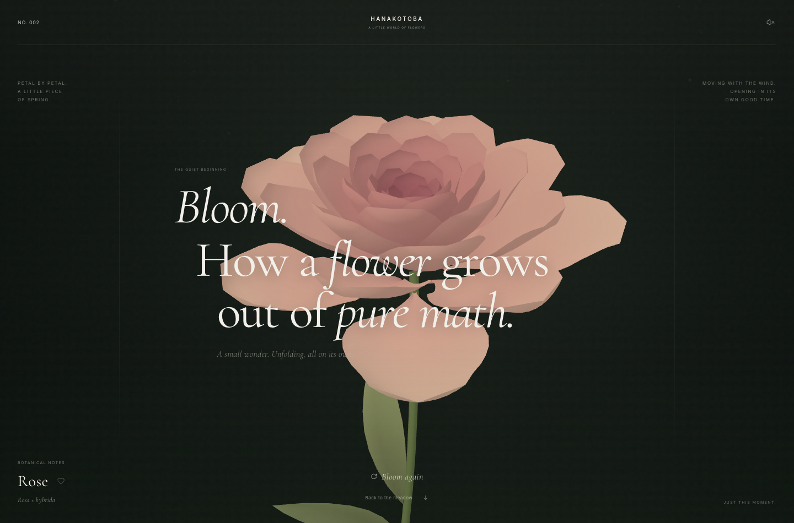

# 花语小庭 · Hanakotoba

手机优先的全屏动态三维花海。主页是温暖的花海、微风与远山；上滑后进入花朵近景，一屏英文描述轻柔地淡入，下滑返回主页。页面以视觉与轻松停留为主。

React + Three.js + React Three Fiber · 程序化花瓣建模 · GPU 实例化 · 日光 / 月夜



[手机文字动画预览](docs/poetry-mobile.png)

## 运行

```sh
git clone https://github.com/ImaginingMaker/flowers.git
cd flowers
npm ci
npm run dev
```

默认地址：http://localhost:5173 。已保存 `.trae/environments/run.json`，可使用 TRAE Run 按钮。服务器监听局域网，同网络的手机可访问电脑的局域网 IP 和端口。

```sh
npm run build
npm run preview
```

使用 Node.js 22.12+；本次环境为 Node.js 24.18。`package-lock.json` 锁定依赖版本。

## 引导式交互

| 操作 | 结果 |
| --- | --- |
| 左右滑动 | 在郁金香、玫瑰、波斯菊、雏菊四片花海间循环切换 |
| 主页上滑 | 相机向花朵推进，一屏英文描述淡入，花朵动画继续播放 |
| 文字模式下滑 | 返回主页，保持原有花种与昼夜状态 |
| 主页下滑 | 切换白天 / 月夜 |
| 文字模式继续上滑或左右滑动 | 保持当前一屏文字，不翻页、不切换花种 |
| 点击日光 / 月色 | 与下滑相同的昼夜切换 |
| 点击底部花种标记、箭头或顶部花海按钮 | 直接选择花海 |
| 鼠标滚轮 | 与手势对应：主页向下滚进入文字，文字模式向上滚返回；主页横向滚动切花 |
| 键盘方向键 | 主页左右切花、上键进入文字、下键切昼夜；文字模式下键 / Escape 返回主页 |

收藏沿用 `hanakotoba-garden` 的本地存储；环境声音默认关闭，开启后合成风声与柔和音符。

## 技术选型与资料

技术选型参考了以下花海、草地、GPU 实例化与风动着色器资料：

| 资料 | 核实内容 | 本次采用 |
| --- | --- | --- |
| [Three.js：InstancedMesh](https://threejs.org/docs/pages/InstancedMesh.html) | 同一几何体和材质可用不同世界变换重复渲染，适合大量相同对象；矩阵更新后需要标记 instanceMatrix.needsUpdate。 | 将每朵花的花瓣、花茎、叶片合并为一个几何体，再按花色和距离分组实例化。 |
| [Codrops：How to Make The Fluffiest Grass With Three.js](https://tympanus.net/codrops/2025/02/04/how-to-make-the-fluffiest-grass-with-three-js/)（2025-02-04） | 系统讨论实例化、分块、LOD、根部阴影、颜色变化和顶点着色器风动；也强调仅减少 draw call 不足以保证性能。 | 实现近 / 远两档几何细节、根部较暗的植物色、依据世界位置错开相位的双正弦风动。本文的草地贴图卡片与百万草叶规模没有照搬。 |
| [R3F：Scaling performance](https://r3f.docs.pmnd.rs/advanced/scaling-performance) | 说明持续帧循环、按需渲染、资源复用、实例化和动态像素密度的取舍。 | 限制 DPR，检测低帧率后降低花海密度；后台与选择面板暂停绘制，减少动态效果偏好下按需绘制。 |
| [use-gesture：Gesture options](https://use-gesture.netlify.app/docs/options/) | 支持目标节点、事件配置、手势阈值、轴向意图等配置。 | 将整个花海作为触摸区，按主要移动方向和距离判断切花 / 详情 / 昼夜，详情顶部单独处理收起手势。 |
| [R3F：Introduction](https://r3f.docs.pmnd.rs/getting-started/introduction) | React Three Fiber 是 Three.js 的 React renderer；Fiber 9 对应 React 19。 | React 19 + Fiber 9 + Three.js 的组合保持不变。 |

视觉选择：全屏透视相机、近处的大花朵、远处密集的小花、起伏草地与远山，建立纵深。日间使用蜜桃色天空、暖阳与珊瑚 / 蜂蜜色花瓣；夜间过渡为靛蓝天空、月牙、星点与漂浮微光。昼夜同时更新场景雾色、灯光、植物着色器和页面颜色。

## 渲染结构

- 主植物全部是本地生成的三维曲面，没有用花海背景图片代替三维建模。
- `meadowGeometry.ts` 合并单花几何体；花色 × 近远两档共六组 InstancedMesh。
- 常规设置下手机使用 885 株花、较宽屏幕使用 1275 株；低帧率档降为 561 株。这是代码配置数量，实际可见数量由构图决定。
- `meadowMaterial.ts` 在 GPU 上根据花根位置和时间弯曲植物顶端；根部保持固定。切换花种时先合拢旧花海的花瓣，再让新花海逐瓣展开。
- 草叶同样实例化并使用风动着色器；云层合并为一个几何体，远山使用简化三维曲面。
- 文字模式在同一 WebGL Canvas 中显示一株近景花，英文直接淡入花朵动画上；花海退去后暂停绘制背景植物，不创建额外渲染器。
- 天空、月牙与星点由 CSS 绘制，花海、地形、云层、风动与漂浮光点由 Three.js 绘制。
- 遵循系统减少动态效果设置；后台暂停风动和声音。WebGL 失败时提供植物标记、提示与重试。

## 主要文件

```text
src/App.tsx                  主页 / 单屏文字模式、方向手势、收藏与昼夜状态
src/PoetryOverlay.tsx        英文描述的淡出、淡入与衬线排版
src/poetry.tsx               单屏英文描述与花海开场文案
src/MeadowScene.tsx          花海实例、地形、相机推进、云与微光
src/meadowGeometry.ts        合并花朵模型、近远细节、植物分布
src/meadowMaterial.ts        GPU 风动、植物明暗、昼夜与雾色
src/botany/petalProfile.ts   五点花瓣轮廓与单顶点圆头拓扑
src/botany/bloomGeometry.ts  花瓣卷曲、含苞与盛开姿态预计算
src/geometry.ts              参数花瓣与叶片曲面
src/data.ts                  花种与花语
src/FlowerIllustration.tsx   收藏与详情中的原创植物 SVG 标记
src/ambient.ts               Web Audio 环境声音
src/styles.css               全屏构图、引导、天空与详情卡片
```

## 从 bloom-animation 吸收的改进

花瓣与盛开算法参考了 `bloom-animation` 的实现及其动画演示。

| 参考位置 | 吸收方式 |
| --- | --- |
| `petalProfile.ts` / `petalMesh.ts` | 采用五点宽度轮廓、平滑插值与圆头封口；末端只保留一个顶点，避免整行顶点压成尖刺或产生退化面。雏菊与波斯菊用新轮廓。 |
| `flowerScene.ts` 的黄金角布局 | 玫瑰从同心圈改为约 137.5° 的螺旋排列，花心向外逐步改变位置、尺寸与倾角，并加入轻微、确定性的错位。 |
| 花瓣曲线积分与卷边 | 用杯形、侧卷、边缘起伏构造玫瑰；分别预计算含苞与盛开时的顶点和法线。 |
| 层次盛开与 easing | 外层和花心错开开启时间，文字模式提供“Bloom again”，约 3.4 秒完成一次展开。 |
| 包裹光与透光 | 在原有暖色光照上添加补光、视角相关的柔和边缘光和花瓣背光透光，保留花心与外缘色差。 |
| 几何体与材质生命周期 | 切换花种时更新和释放模型，保留风动材质，减少重复编译着色器。 |

参考项目主要展示一朵精细花；当前首屏是数百株花海。因此保留整花实例化、近远两档模型和更精细的单株近景。参考项目每帧执行的曲线积分移到建模阶段，GPU 只混合两个姿态，中间形变是近似。保留当前暖色花海构图与手势导航，采用 CPU 轮廓计算也避免依赖浮点纹理线性过滤。

复用与改编的代码出处及 MIT 许可见 [第三方声明](THIRD_PARTY_NOTICES.md)。

## 验证与限制

- TypeScript 检查与生产构建通过。
- 在 Chromium 设备模拟中验证主页左右切花、主页下滑切昼夜、上滑显示一屏英文，以及文字模式下滑返回主页。
- 验证文字模式重复上滑、左右滑动不会翻页或切花；返回主页时保留花种和昼夜状态，不会误切昼夜。
- 文字模式没有介绍弹窗、阅读进度或多屏入口；收藏选择面板仍支持焦点锁定与 Escape 关闭。
- 检查手机、平板与桌面尺寸；浏览器模拟不能替代真实手机。
- 一次手机视口采样记录为 14 次 draw call、约 22.5 万三角形（郁金香低密度档）。该记录用于检查渲染组织，不能推导真实手机帧率。
- 减少动态效果下的按需渲染、WebGL 故障恢复、滚轮与键盘方向导航验证通过；对同一花海的不同帧截图检查确认前景植物持续运动。
- 未做真实 iPhone / Android 上的持续帧率、温度和耗电测试；不保证所有设备达到 60 FPS。
- 三维花海需要 WebGL 2。场景模块懒加载，压缩后约 244 KB，Vite 仍提示未压缩模块较大。
- 中文字体通过 Google Fonts 加载 Noto Serif SC，无法联网时使用系统宋体回退。
- 当前是程序化建模的风格化花海；进一步追求电影级植物造型可引入艺术家制作的 GLB，并重新验证移动端负载。

## 开源许可

本项目使用 [MIT License](LICENSE)。改编的第三方代码保留原版权声明，详见 [THIRD_PARTY_NOTICES.md](THIRD_PARTY_NOTICES.md)。
